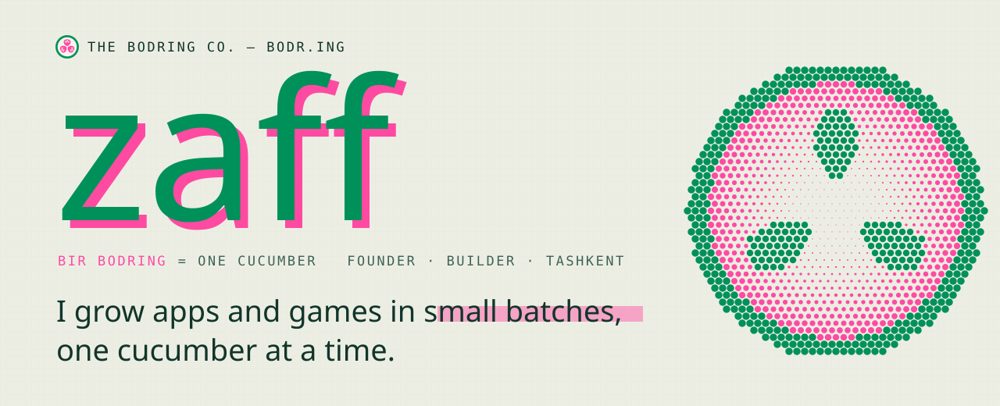
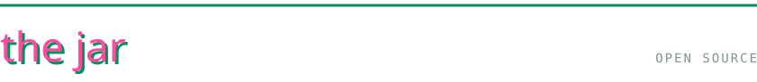
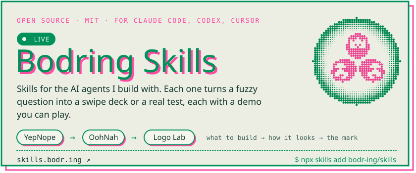
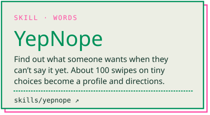
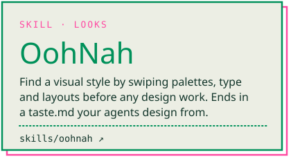
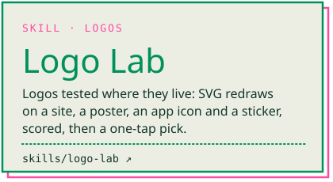
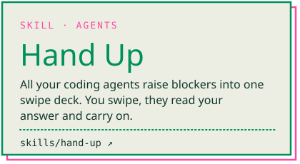
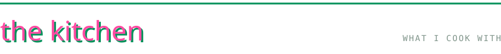
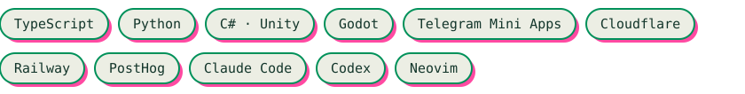
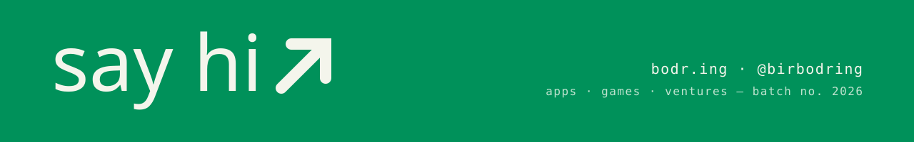

<a href="https://bodr.ing"></a>

Hi, I'm **Zafar**. I run [The Bodring Company](https://bodr.ing), a small studio in Tashkent that grows apps and games in small batches. *Bir bodring* means "one cucumber" in Uzbek. Most of the building is done with a crew of AI agents, and the skills I give them are open source.



<a href="https://skills.bodr.ing"></a>

<p>
<a href="https://github.com/bodr-ing/skills/tree/main/skills/yepnope"></a>
<a href="https://github.com/bodr-ing/skills/tree/main/skills/oohnah"></a>
<a href="https://github.com/bodr-ing/skills/tree/main/skills/logo-lab"></a>
<a href="https://github.com/bodr-ing/skills/tree/main/skills/hand-up"></a>
</p>

```text
npx skills add bodr-ing/skills
```





<a href="https://bodr.ing"></a>
